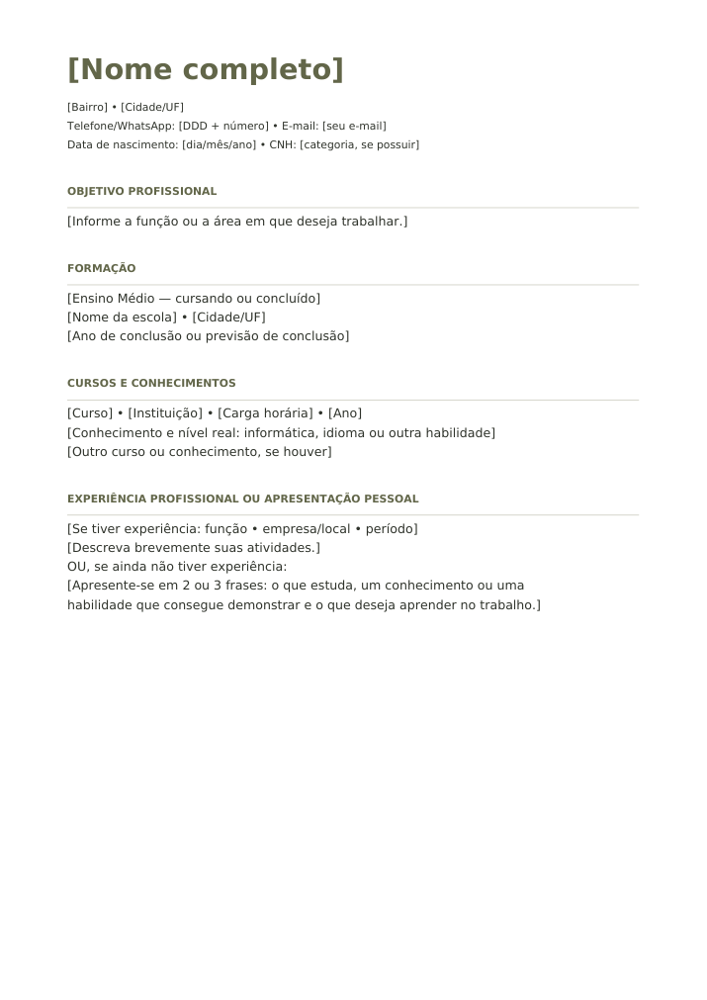
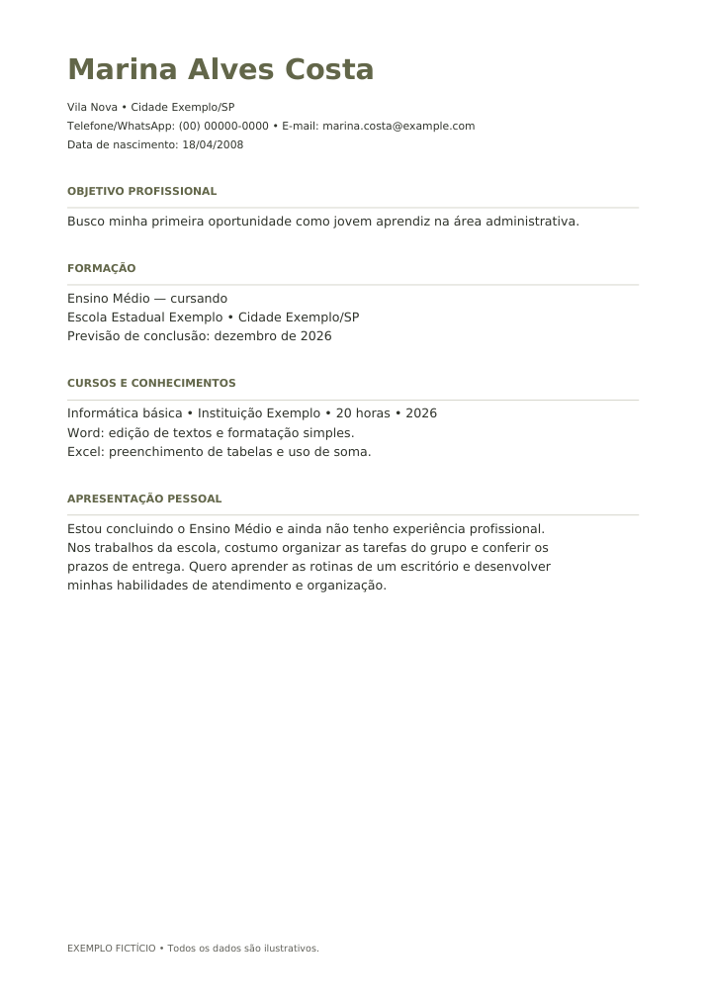

# Material 1 — Modelo de currículo

Primeira versão para aprovação da autora de **O Manual para o Primeiro Emprego**.

## Arquivos

- [Modelo em PDF](modelo-curriculo.pdf)
- [Modelo editável em Word](modelo-curriculo.docx)
- [Exemplo fictício em PDF](exemplo-curriculo.pdf)
- [Exemplo fictício editável em Word](exemplo-curriculo.docx)
- [Orientações de preenchimento](orientacoes.txt)

Os PDFs têm uma página. Para editar, baixe o DOCX e abra no Word, Google Docs ou LibreOffice. No GitHub, use o botão de download do arquivo caso a visualização não esteja disponível.

## Modelo

## Exemplo fictício

Todos os dados são ilustrativos. O telefone é propositalmente inválido e o e-mail utiliza o domínio reservado example.com.

