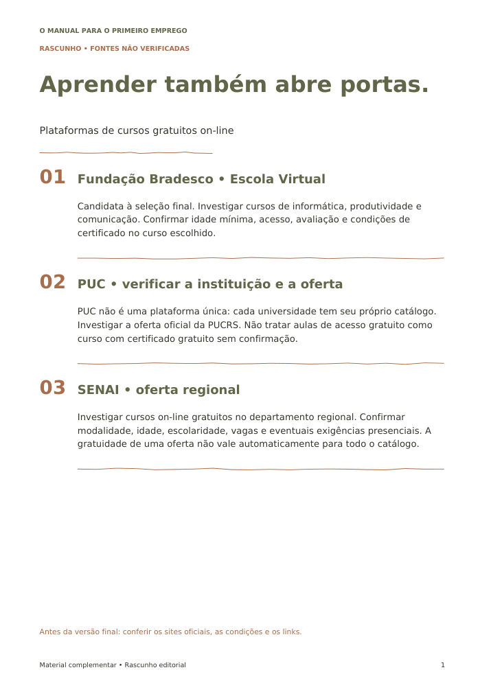
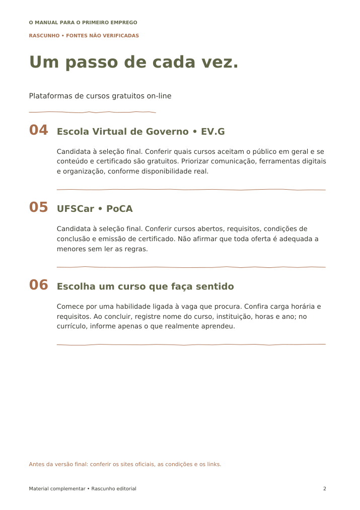

# Plataformas de cursos gratuitos on-line

**Rascunho para a autora — pesquisa pendente.** As consultas foram bloqueadas pelo proxy do ambiente em 09/10/2026 com erro 403 antes de alcançar os sites. Isso não demonstra que os sites estejam fora do ar. Não foram confirmados funcionamento dos links, gratuidade, requisitos ou certificados.

Os nomes abaixo são candidatos à pesquisa, e não recomendações já validadas. URLs de acesso serão incluídas somente depois da conferência.

## Fundação Bradesco • Escola Virtual

Candidata à seleção final. Investigar cursos de informática, produtividade e comunicação. Confirmar idade mínima, acesso, avaliação e condições de certificado no curso escolhido.

## PUC • verificar a instituição e a oferta

PUC não é uma plataforma única: cada universidade tem seu próprio catálogo. Investigar a oferta oficial da PUCRS. Não tratar aulas de acesso gratuito como curso com certificado gratuito sem confirmação.

## SENAI • oferta regional

Investigar cursos on-line gratuitos no departamento regional. Confirmar modalidade, idade, escolaridade, vagas e eventuais exigências presenciais. A gratuidade de uma oferta não vale automaticamente para todo o catálogo.

## Escola Virtual de Governo • EV.G

Candidata à seleção final. Conferir quais cursos aceitam o público em geral e se conteúdo e certificado são gratuitos. Priorizar comunicação, ferramentas digitais e organização, conforme disponibilidade real.

## UFSCar • PoCA

Candidata à seleção final. Conferir cursos abertos, requisitos, condições de conclusão e emissão de certificado. Não afirmar que toda oferta é adequada a menores sem ler as regras.

## Escolha um curso que faça sentido

Comece por uma habilidade ligada à vaga que procura. Confira carga horária e requisitos. Ao concluir, registre nome do curso, instituição, horas e ano; no currículo, informe apenas o que realmente aprendeu.

## Arquivos para avaliação visual

- [PDF do rascunho](guia-rascunho.pdf)
- [Word editável](guia-rascunho.docx)

