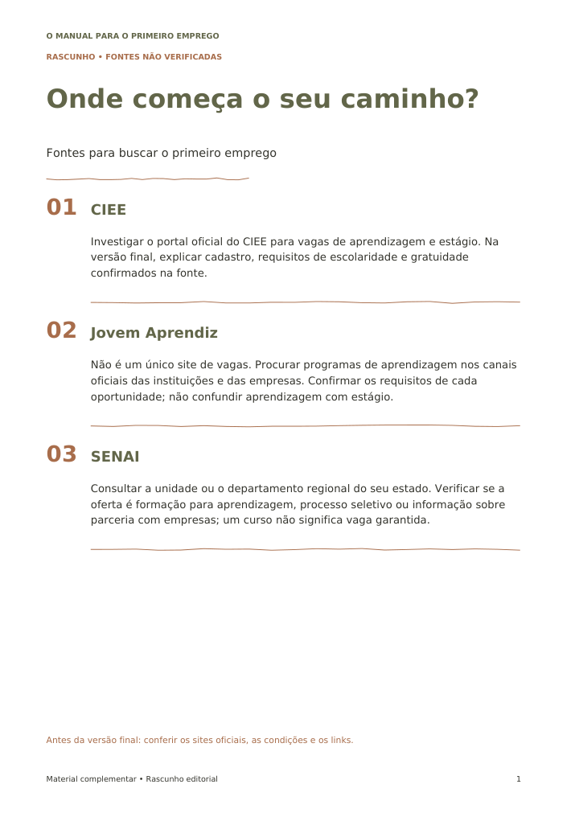
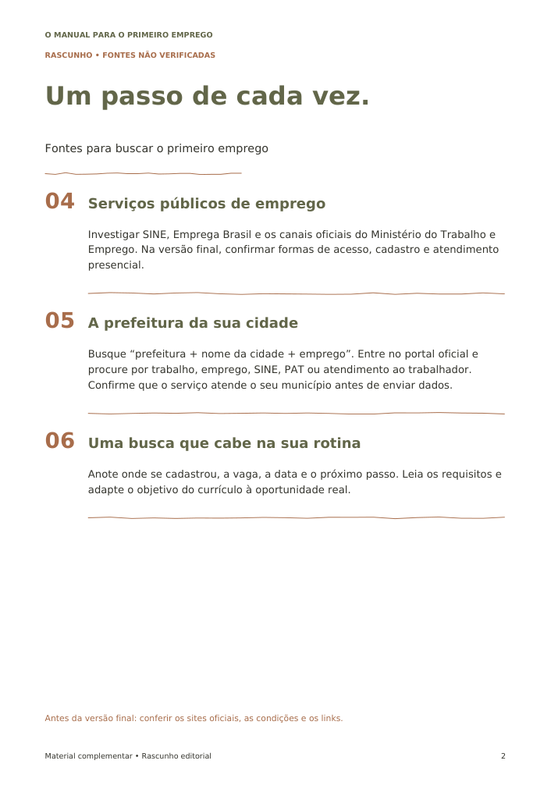

# Fontes para buscar o primeiro emprego

**Rascunho para a autora — pesquisa pendente.** As consultas foram bloqueadas pelo proxy do ambiente em 09/10/2026 com erro 403 antes de alcançar os sites. Isso não demonstra que os sites estejam fora do ar. Não foram confirmados funcionamento dos links, gratuidade, requisitos ou certificados.

Os nomes abaixo são candidatos à pesquisa, e não recomendações já validadas. URLs de acesso serão incluídas somente depois da conferência.

## CIEE

Investigar o portal oficial do CIEE para vagas de aprendizagem e estágio. Na versão final, explicar cadastro, requisitos de escolaridade e gratuidade confirmados na fonte.

## Jovem Aprendiz

Não é um único site de vagas. Procurar programas de aprendizagem nos canais oficiais das instituições e das empresas. Confirmar os requisitos de cada oportunidade; não confundir aprendizagem com estágio.

## SENAI

Consultar a unidade ou o departamento regional do seu estado. Verificar se a oferta é formação para aprendizagem, processo seletivo ou informação sobre parceria com empresas; um curso não significa vaga garantida.

## Serviços públicos de emprego

Investigar SINE, Emprega Brasil e os canais oficiais do Ministério do Trabalho e Emprego. Na versão final, confirmar formas de acesso, cadastro e atendimento presencial.

## A prefeitura da sua cidade

Busque “prefeitura + nome da cidade + emprego”. Entre no portal oficial e procure por trabalho, emprego, SINE, PAT ou atendimento ao trabalhador. Confirme que o serviço atende o seu município antes de enviar dados.

## Uma busca que cabe na sua rotina

Anote onde se cadastrou, a vaga, a data e o próximo passo. Leia os requisitos e adapte o objetivo do currículo à oportunidade real.

## Arquivos para avaliação visual

- [PDF do rascunho](guia-rascunho.pdf)
- [Word editável](guia-rascunho.docx)

